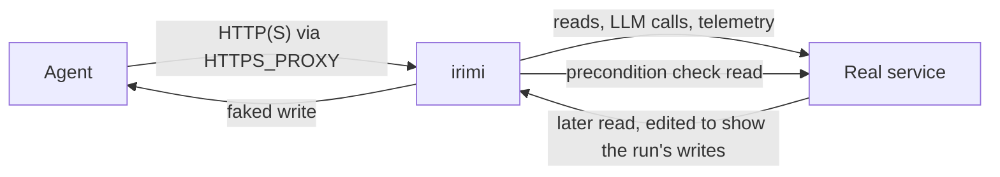

# irimi

[](https://github.com/HenryLiu714/Irimi/actions/workflows/ci.yml)
[](https://pypi.org/project/irimi/)
[](https://pypi.org/project/irimi/)
[](https://github.com/HenryLiu714/Irimi/blob/main/LICENSE)

*Shadow mode for AI agents: reads are real, writes are faked, and reads see the writes.*

irimi is a local proxy you put between an agent and the services it calls. Reads pass through to
the real service. Writes over HTTP(S) that go through irimi are answered with a realistic fake
success, and the agent's later reads are edited to show those writes, so what it sees stays
consistent. At the end you get a list of every write the agent would have made, and which of them
the real service would have refused. Only traffic sent through the proxy is shadowed: read
[What irimi does not catch](#what-irimi-does-not-catch) before you rely on it.

It is for teams that do not yet trust an agent with write access: run it against production reads
for real, and see what it would have done before anything happens.

## What you get

An LLM support agent handles a ticket and refunds the same charge twice. Under irimi, Stripe sees
neither refund, the agent gets Stripe's own error for the second, and the summary says so
(`make demo EXAMPLE=w01`, from a clone):

```
irimi shadow · run 2e850c92f0cae79a (whole process) · 10 exchanges · 0.1s

  None of these writes reached the real service:
  ○ stripe  refund $49.00 on ch_TICKET1  faked; checked against live state: would succeed
  ✗ stripe  refund $49.00 on ch_TICKET1  faked; would fail: charge_already_refunded
  ○ tool  tests.e2e.workflows.agents.w01_ticket_triage.agent:send_reply  fake ran instead
  money: $98.00 in faked writes; $49.00 of it would fail
  would have fired: refund.created, charge.refunded

  api.anthropic.com  5 llm
  api.stripe.com     1 read  2 irimi check reads  2 faked writes

  10 exchanges · 8 real · 2 answered by irimi (2 faked writes) · 0 sent to targets

  run 9543771d  tests.e2e.workflows.agents.w01_ticket_triage.agent:handle_ticket(...)  10 exchanges · 2 writes
  replay with: irimi replay 9543771d
```

## Why

You cannot give an agent production write access until you have seen what it does with it, and a
staging environment does not hold production's data. irimi lets the agent read production and
keeps every write on your machine.

| Approach | Reads | Writes | What it misses |
| --- | --- | --- | --- |
| Stripe test mode | test data | real, in test mode | your production customers, charges and history |
| VCR / cassettes | recorded once | replayed from the recording | anything the recording did not hold; state after a write |
| Hand-written mocks | whatever you wrote | whatever you wrote | the real service's answers and errors |
| A staging environment | staging data | real, in staging | production's data, and the cost of keeping staging in step |
| irimi | live, from production | faked, then shown to later reads | traffic that bypasses the proxy ([below](#what-irimi-does-not-catch)) |

A faked refund is checked against the real charge first, so a refund Stripe would refuse comes
back with Stripe's own error, as the second refund above did.

## Quickstart

Requires Python 3.12+ (standard, not free-threaded, builds) on macOS or Linux.

```
uv tool install --python 3.12 irimi    # or: pipx install --python python3.12 irimi
irimi init                             # generates a local CA in ~/.irimi/ca/
```

A first write, under shadow. It needs no network and no key, because the write never leaves your
machine:

```
irimi shadow -- curl -s -X POST https://api.stripe.com/v1/customers/cus_REAL123 \
  -d 'metadata[order_id]=6735' -d email=a@example.com
```

curl gets back a whole Stripe customer object with your `email` and `metadata`, and the header
`irimi-answered-by: fake-L1`. irimi prints:

```
irimi shadow · run 8a1091f8c67628aa · listening on 127.0.0.1:58322 · ca /Users/you/.irimi/ca/ca.pem
only traffic sent through this proxy is shadowed; a client that ignores HTTPS_PROXY talks to the real service
faked         write     POST api.stripe.com/v1/customers/cus_REAL123 -> 200
irimi shadow · run 8a1091f8c67628aa · 1 exchange · 0.0s

  None of these writes reached the real service:
  ○ stripe  update customer cus_REAL123  faked; not checked
  would have fired: customer.updated

  api.stripe.com  1 faked write

  1 exchange · 0 real · 1 answered by irimi (1 faked write) · 0 sent to targets
```

Then an agent: [`examples/hello_agent.py`](https://github.com/HenryLiu714/Irimi/blob/main/examples/hello_agent.py)
is 25 lines of stdlib Python that reads GitHub and posts a Stripe refund and a Slack webhook.
Download it or clone the repository; it needs no keys:

```
irimi shadow -- python3 examples/hello_agent.py
```

The summary shows the GitHub read as real and both writes as faked. irimi's check read of the
charge comes back `401`, because the example's key is a placeholder, so the refund line says
`faked; could not check: stripe answered irimi's check read with 401`. From a clone, `make demo`
runs the same agent against fake services on loopback, with no network at all. Your own agent runs
the same way: `irimi shadow -- python3 -m your_agent`.

## What is supported

| Service | Reads | Writes |
| --- | --- | --- |
| Stripe | live | a whole Stripe object; later reads show it; refunds checked against the real charge |
| Slack (Web API and incoming webhooks) | live | a whole message; channel history shows it; posts checked against the real channel |
| OpenAI, Anthropic | LLM calls live, streamed | any other write on those hosts is an echo |
| LangSmith, Langfuse, Sentry, Datadog, Honeycomb, PostHog | telemetry live, stored only as a count | |
| Any other HTTP API | `GET`, `HEAD`, `OPTIONS` live | an echo of the request, with ids minted |

Service maps ship with irimi; add one by pull request
([adding a service](https://github.com/HenryLiu714/Irimi/blob/main/docs/adding-a-service.md)).
`irimi maps list` prints every mapped host.

## What irimi does not catch

- **Only HTTP(S) through the proxy.** A client that ignores `HTTPS_PROXY` talks to the real
  service. A client that ships its own CA bundle, as stripe-python does, fails TLS instead, and the
  summary counts it; give it irimi's proxy and CA, or use base-URL mode, for SDKs that ignore proxy
  settings ([what the child gets](https://github.com/HenryLiu714/Irimi/blob/main/docs/how-it-works.md#what-the-child-gets)).
  The [known bypasses](https://github.com/HenryLiu714/Irimi/blob/main/docs/security.md#known-bypasses)
  are each pinned by the sample workflow `w11_leaky_agent`.
- **How to check.** Every answer irimi made carries an `Irimi-Answered-By` header. A write with no
  line in the summary went to the real service.
- **Databases, files, gRPC and WebSockets** happen for real, unless the agent wraps the function
  that makes them in `@sdk.write_tool`. Point database URLs at scratch data.
- **Runs need labelled requests.** `sdk.instrument()` labels requests made through `http.client`
  (urllib, requests, urllib3) and `httpx`, but not other transports, such as the `httpx2` that
  anthropic 2.x uses. Those need `Irimi-Run` set by hand; see
  [the SDK guide](https://github.com/HenryLiu714/Irimi/blob/main/docs/sdk.md).
- **Under `irimi serve`, each run sees only its own faked writes.** A refund one run faked does
  not refuse another run's refund of the same charge, though production would.
- **Stored runs hold what the agent read.** Credentials are redacted; business data is not.
  `irimi runs rm` and `irimi runs prune` delete runs.

The full list is in [limitations](https://github.com/HenryLiu714/Irimi/blob/main/docs/limitations.md).

## How it works



- **Classification.** A service map says whether each route is a read, a write, an LLM call or
  telemetry. A request no map names is a read only if its method is `GET`, `HEAD` or `OPTIONS`;
  anything else is faked, never sent.
- **Faked writes.** A write gets an echo of its own fields, or a whole object from a vendored
  fixture. Before faking it, irimi can make one real read (a precondition check) and answer with the
  error the service would have given.
- **The overlay.** The agent's later reads of the same service are edited to show the run's
  faked writes: a re-read charge shows the refund, and a list holds the new object.
- **The answer header.** Every response irimi decided carries `Irimi-Answered-By` (`fake-L0` for
  an echo, `fake-L1` for a fixture, `overlay`, `delegated` for a target, `recording`, or `irimi` for
  irimi's own error). A response without it came from the real service, unchanged.

More in [how it works](https://github.com/HenryLiu714/Irimi/blob/main/docs/how-it-works.md).

## Going further

- [Documentation index](https://github.com/HenryLiu714/Irimi/blob/main/docs/README.md): every page below, by audience.
- [Concepts](https://github.com/HenryLiu714/Irimi/blob/main/docs/concepts.md): the terms irimi uses, in one glossary.
- [How it works](https://github.com/HenryLiu714/Irimi/blob/main/docs/how-it-works.md): a request, `irimi shadow`, `irimi serve` and `irimi replay`, step by step.
- [Reading the summary](https://github.com/HenryLiu714/Irimi/blob/main/docs/reading-the-summary.md): every line and status the summary prints.
- [Security](https://github.com/HenryLiu714/Irimi/blob/main/docs/security.md): the threat model, the local CA, redaction and the rules every run keeps.
- [Limitations](https://github.com/HenryLiu714/Irimi/blob/main/docs/limitations.md): what irimi cannot see or fake.
- [Service maps](https://github.com/HenryLiu714/Irimi/blob/main/docs/service-maps.md): the map schema, key by key, and targets you control.
- [Adding a service](https://github.com/HenryLiu714/Irimi/blob/main/docs/adding-a-service.md): a new map, and the Python a service needs for full objects and checks.
- [The SDK](https://github.com/HenryLiu714/Irimi/blob/main/docs/sdk.md): mark runs and the tools the proxy cannot see.
  `pip install irimi` brings the proxy's dependencies (mitmproxy among them) along with the SDK,
  though the SDK imports only the standard library and irimi's own modules.
- [Serve mode](https://github.com/HenryLiu714/Irimi/blob/main/docs/serve-mode.md): irimi as a sidecar to an agent that serves.
- [Replay](https://github.com/HenryLiu714/Irimi/blob/main/docs/replay.md): record a run, compare two runs, and replay one against its recording.
- [The CLI](https://github.com/HenryLiu714/Irimi/blob/main/docs/cli.md): every command, flag and exit code.
- [The control protocol](https://github.com/HenryLiu714/Irimi/blob/main/docs/control-protocol.md): how an agent in any language reports its runs.
- [The trace format](https://github.com/HenryLiu714/Irimi/blob/main/docs/trace-format.md): what a stored run holds on disk.
- [Architecture](https://github.com/HenryLiu714/Irimi/blob/main/docs/architecture.md): the code, for contributors.

## CLI

```
irimi init [--force]                 create the local CA in ~/.irimi (or $IRIMI_HOME)
irimi shadow [options] -- CMD        run a command with its HTTP(S) writes faked, then summarize
irimi serve [options]                run the proxy for agents you start yourself, until stopped
irimi replay RUN [options] [-- CMD]  re-run a stored run against its recorded responses and show what changed
irimi runs [list] [--limit N|--all]  list stored runs, newest first
irimi runs show [RUN]                show one stored run
irimi runs rm RUN...                 delete stored runs
irimi runs prune --older-than 30d    delete stored runs older than a duration
irimi compare RUN_A RUN_B            show the writes two stored runs made, side by side
irimi maps [list] [map options]      list each mapped host with its service, route count and target
```

`irimi <command> --help` lists each command's options, with examples; `shadow`, `replay` and
`compare` also list their exit codes.

## Examples

- [`hello_agent.py`](https://github.com/HenryLiu714/Irimi/blob/main/examples/hello_agent.py): one real read and two faked writes, stdlib only.
- [`quickstart/`](https://github.com/HenryLiu714/Irimi/blob/main/examples/quickstart/README.md): a stripe-python refund agent whose retry is refused.
- [`replay/`](https://github.com/HenryLiu714/Irimi/blob/main/examples/replay/README.md): an agent on the `anthropic` SDK, recorded, its prompt edited, and replayed.
- [`sidecar/`](https://github.com/HenryLiu714/Irimi/blob/main/examples/sidecar/README.md): a server agent beside `irimi serve` in its own container.

[`examples/README.md`](https://github.com/HenryLiu714/Irimi/blob/main/examples/README.md) says what
each needs. From a clone, `make demo EXAMPLE=quickstart` (or `replay`) runs one against fake
services, with no keys.

## Status and roadmap

Alpha. irimi is 0.x: a minor release may change the CLI, the SDK or the map schema, and
[`CHANGELOG.md`](https://github.com/HenryLiu714/Irimi/blob/main/CHANGELOG.md) marks each breaking
change with how to migrate. Next:

- detecting clients that bypass the proxy;
- reports over many runs of an agent;
- behaviour diffs of an agent on pull requests;
- more service maps.

Ideas and bugs go in the [issues](https://github.com/HenryLiu714/Irimi/issues).

## Troubleshooting

**Build fails in pylsqpack** (`error: call to undeclared function '_Py_DecRefShared'`): uv picked a
free-threaded Python, for which mitmproxy's dependencies have no wheels. Ask for a GIL build:
`uv tool install --python 3.12 irimi`, or in a clone, `scripts/setup.sh`, which installs one.

## Contributing, security and license

- [`CONTRIBUTING.md`](https://github.com/HenryLiu714/Irimi/blob/main/CONTRIBUTING.md): setup, tests and conventions.
- [`SECURITY.md`](https://github.com/HenryLiu714/Irimi/blob/main/SECURITY.md): how to report a vulnerability, and how to remove irimi.
- Apache-2.0; see [`LICENSE`](https://github.com/HenryLiu714/Irimi/blob/main/LICENSE).
