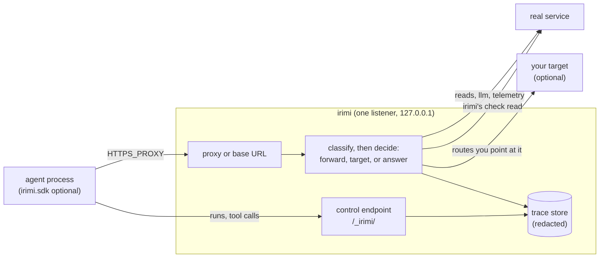

# How it works

For users who want to know what happens to their agent's traffic, and for security reviewers
tracing a request end to end. It follows one request through irimi, then the three ways irimi
runs: `irimi shadow -- <cmd>`, `irimi serve` and `irimi replay`. The terms are defined in
[concepts.md](concepts.md); the guarantees are in [security.md](security.md).

## One request

1. **Admission.** The request arrives through the proxy or in base-URL mode. A request addressed to
   irimi's own listener under `/_irimi/` goes to the control endpoint and is never forwarded or
   recorded as an exchange. irimi reads the run id from `Irimi-Run` (else the engine's own run)
   and takes `Irimi-Run` and `Irimi-Rewrote` off the request. A request irimi cannot parse or
   route gets irimi's own `400` or `403`.
2. **Decision**, on a worker thread so other requests keep moving:
   - classify the request ([concepts.md](concepts.md#terms));
   - if a target answers it, send it there;
   - a live kind (`read`, `llm`, `telemetry`) is forwarded. A read whose list cursor names an id
     irimi minted is translated first, since the real service has never heard of that id;
   - a retry of an idempotency key gets the first answer again;
   - a write whose route has a precondition check gets irimi's check read; a rejection is answered
     with the service's own error;
   - any other write is faked, from its fixture or as an echo.
3. **Answer.** A forwarded read's body passes the overlay, which applies the run's faked writes. A
   `text/event-stream` answer streams through chunk by chunk and is never edited. Every answer
   irimi decided is stamped `Irimi-Answered-By`.
4. **Record.** The exchange, and any check read irimi made for it, go to the trace store, which
   redacts them on its own thread. A faked write joins its run's write log.

If anything in steps 1 to 3 fails, the request gets irimi's own error answer and is never
forwarded (the fail-closed hook rule).

## `irimi shadow -- <cmd>`

1. Load the maps, the CA and the redaction key, and open the store. A map or flag the loader
   refuses stops here, with the rule it broke.
2. Check that the command resolves (exit 127 or 126 if not), start the proxy on a free port, and
   print the banner.
3. Store a `process` run and start the command with the environment below.
4. Print one line per exchange and tool call as each finishes (`--quiet` skips these).
5. When the command exits, end the run with its exit code, flush the store, and print the
   summary ([reading-the-summary.md](reading-the-summary.md)). irimi exits with the command's code.

One process tree is one run, unless the agent uses the SDK: then each trigger call is its own
`sdk` run, and the summary ends with a line per SDK run and how to replay it. SIGINT and SIGTERM
are passed to the command, whose exit then ends the run as any exit does.

## `irimi serve`

The proxy alone, as a sidecar to an agent irimi does not launch, until SIGINT or SIGTERM. There is
no child and no process run: every run is one the SDK names, and requests no run names are stored
as `unattributed`. Each run's summary prints when the SDK ends it. Details, including what the
agent's container needs, are in [serve-mode.md](serve-mode.md).

## `irimi replay RUN`

1. Load the stored run and decide what to run: `-- CMD`, else a function (`--entrypoint`, or the
   run's recorded trigger) called with `--args` or the recorded arguments, else the process run's
   recorded command.
2. Start the proxy in replay mode and a child that runs it. Every run the child's SDK starts adopts
   the replay's one run.
3. Answer each request the recording holds with its recorded answer; decide anything else as
   shadow mode would. Writes are never forwarded.
4. Store the replay as a run with `mode: replay` and `replay_of`, then compare its writes with the
   recorded run's and exit as `irimi compare` does.

Matching, divergence and the comparison are in [replay.md](replay.md).

## What the child gets

`irimi shadow` and `irimi replay` start their child with these variables set, replacing any it
inherited:

| Variable | Value | Why |
| --- | --- | --- |
| `HTTP_PROXY`, `HTTPS_PROXY`, `http_proxy`, `https_proxy` | `http://127.0.0.1:PORT` | every request goes through irimi; clients disagree on the case they read |
| `NO_PROXY`, `no_proxy` | `localhost,127.0.0.1` | loopback services are reached directly |
| `NODE_USE_ENV_PROXY` | `1` | Node's `fetch` honours the proxy variables |
| `SSL_CERT_FILE`, `REQUESTS_CA_BUNDLE`, `CURL_CA_BUNDLE`, `NODE_EXTRA_CA_CERTS` | irimi's `ca.pem` | the child trusts irimi's certificates |
| `IRIMI_ENGINE_ACTIVE` | `1` | turns the SDK on |
| `IRIMI_RUN` | the process run's id | the run a request with no `Irimi-Run` belongs to |
| `IRIMI_CONTROL` | `http://127.0.0.1:PORT/_irimi` | where the SDK reports runs and tool calls |
| `IRIMI_REPLAY_RUN` | the replay's run id | replay only: the SDK adopts this run |
| `IRIMI_REPLAY_CALL`, `IRIMI_REPLAY_ARGS_FILE`, `IRIMI_REPLAY_OUTCOME_FILE` | | replay of a function only: what the replay child calls, with which arguments, and where it reports how the call ended |

This covers `requests`, `httpx`, `urllib`, `curl` and Node's `fetch` with no code change. The CA
variables replace the child's trust store rather than adding to it, so a TLS client that skips the
proxy (anything on `localhost`) fails to verify; give it plain HTTP or its own bundle. Some clients
ignore `SSL_CERT_FILE` (stripe-python ships its own bundle, and macOS's system Python uses its own
store): such a client fails TLS, and the summary says so per host. For stripe-python, set
`stripe.ca_bundle_path` and `stripe.proxy`, or use base-URL mode.
